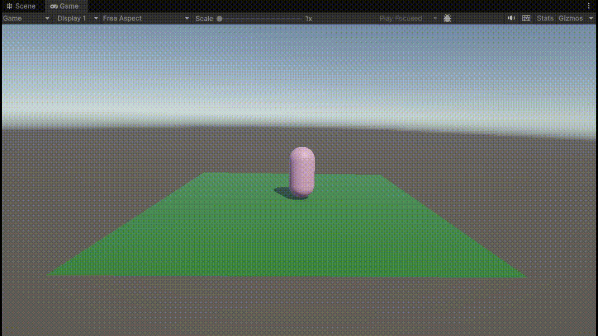
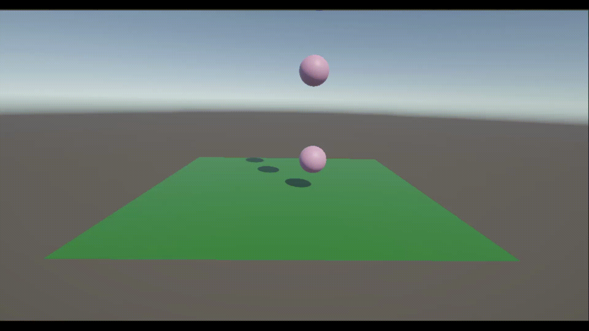
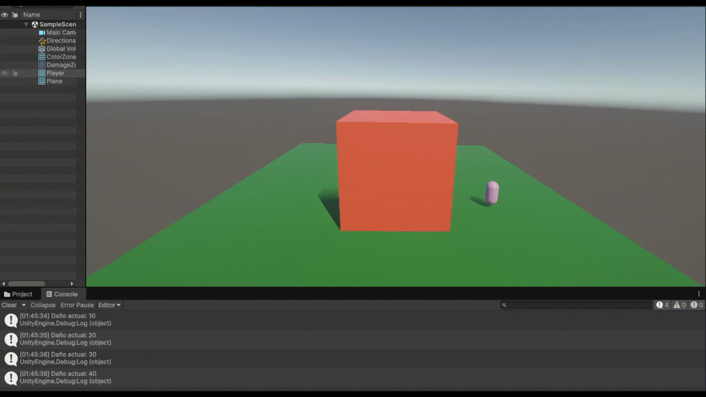
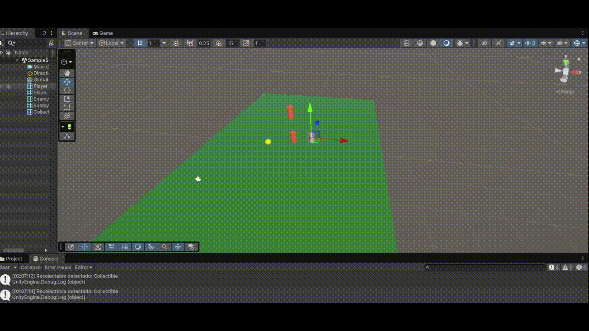
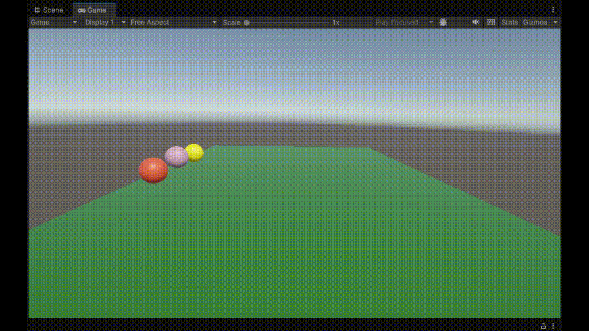
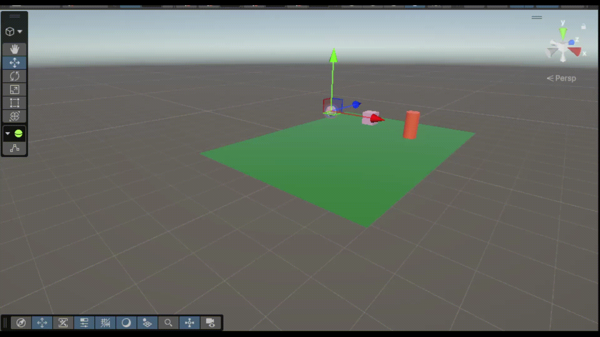

# IIPr2 - Introducción a la física en Unity

- **Ejercicio 1 — Movimiento de un personaje con Rigidbody:** El script `PlayerMovement` obtiene los ejes horizontal y vertical, calcula una dirección normalizada y actualiza la velocidad del `Rigidbody` en `FixedUpdate`, manteniendo el control del desplazamiento mediante las teclas WASD o las flechas.
	- Script: [scripts/PlayerMovement.cs](scripts/PlayerMovement.cs)
	- Gif de ejecución: 
- **Ejercicio 2 — Detección de colisiones y cambio de color:** El script `CollisionDetector` detecta las colisiones mediante `OnCollisionEnter`, muestra por consola el nombre del objeto con el que se ha producido el contacto y cambia aleatoriamente el color del objeto.
	- Script: [scripts/CollisionDetector.cs](scripts/CollisionDetector.cs)
	- Gif de ejecución: 
- **Ejercicio 3 — Zonas de color y daño:** El script `ColorZone` cambia temporalmente a verde el material del jugador al entrar en una zona trigger y restaura su color original al salir. El script `DamageZone` incrementa una variable de daño cada vez que el jugador entra en la zona y muestra el valor actual por consola.
	- Scripts: [scripts/ColorZone.cs](scripts/ColorZone.cs), [scripts/DamageZone.cs](scripts/DamageZone.cs)
	- Gif de ejecución: 
- **Ejercicio 4 — Layer Collision Matrix y recolectables:** se configuran las capas de jugador, enemigos y recolectables en la `Layer Collision Matrix` de Unity para controlar sus interacciones. El script `CollectibleDetector` detecta mediante un trigger los objetos de la capa `Collectible` y muestra su nombre por consola.
	- Configuración: Project Settings > Physics > Layer Collision Matrix
	- Script: [scripts/CollectibleDetector.cs](scripts/CollectibleDetector.cs)
	- Gif de ejecución: 
- **Ejercicio 5 — Materiales físicos y lanzamiento:** se aplican distintos `Physic Materials` a los objetos para observar sus diferencias de fricción y rebote. El script `ObjectLauncher` aplica una fuerza impulsiva hacia la derecha con `AddForce()` al pulsar la tecla `X`.
	- Script: [scripts/ObjectLauncher.cs](scripts/ObjectLauncher.cs)
	- Gif de ejecución: 
- **Ejercicio 6 — Persecución de una esfera y obstáculo:** el script `SphereChaser` mueve una esfera hacia un objetivo utilizando un `SphereCast` para detectar el cubo situado entre ambos. Cuando alcanza el obstáculo, cambia su material y muestra un mensaje por consola; si no encuentra obstáculos, continúa avanzando hacia el cilindro.
	- Script: [scripts/SphereChaser.cs](scripts/SphereChaser.cs)
	- Gif de ejecución: 